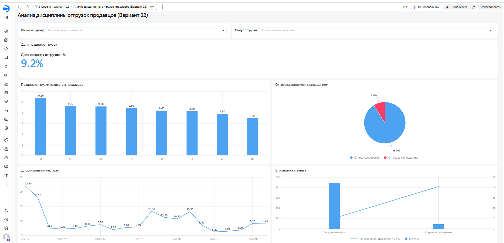

# ЛР-3. Аналитический дашборд для бизнес-кейса — вариант 22

**Студент:** Овсепян Милена · **группа:** БД-251м
**Бизнес-кейс:** Дисциплина отгрузки продавцов

## Цель работы
Соблюдают ли продавцы срок передачи товара перевозчику и как просрочка отгрузки влияет на опоздание к клиенту?

## Исследуемые метрики
- **Доля поздних отгрузок** = `COUNT_IF([handover_status] = 'Отгрузка с опозданием') / COUNT([order_id])`
- **Доля опозданий к клиенту** = `AVG([customer_late])`

## Архитектура решения
Kaggle (Olist, 9 CSV) → Python (`urllib`, `pandas`) → SQLite: RAW → STAGING → CORE → витрина `dm_v22_seller_shipping` → CSV → Yandex DataLens.

## Технологический стек
Python 3.13.18, pandas 2.2.3, SQLite 3.45.1, Google Colab / Jupyter, Yandex DataLens.

## Схема данных
Слои: `raw_*` (9 таблиц) → `stg_*` (типизация, очистка) → `core_order`, `core_item`, `dim_state` → `dm_v22_seller_shipping` (VIEW).
<!-- вставьте скриншот или ER-диаграмму: img/er.png -->

## SQL витрины
```sql
CREATE VIEW dm_v22_seller_shipping AS
SELECT 
    i.order_id,
    i.order_item_id,
    i.seller_id,
    i.seller_state,
    i.seller_region,
    strftime('%Y-%m-01', i.purchase_ts) AS month,
    CASE 
        WHEN i.carrier_ts IS NULL THEN 'Нет данных об отгрузке'
        WHEN i.carrier_ts > i.shipping_limit_ts THEN 'Отгрузка с опозданием'
        ELSE 'Отгрузка вовремя'
    END AS handover_status,
    ROUND((julianday(i.carrier_ts) - julianday(i.shipping_limit_ts)) * 24, 2) AS handover_delay_hours,
    COALESCE(i.is_late, 0) AS customer_late
FROM core_item i
WHERE i.carrier_ts IS NOT NULL
  AND i.purchase_month BETWEEN '2017-01-01' AND '2018-08-01'
```

## Контрольные значения
| Вопрос | Ответ |
|---|---|
| Доля поздних отгрузок, % | 9.2 |
| Опоздание к клиенту при поздней отгрузке, % | 20.5 |

## Дашборд DataLens
Ссылка: https://datalens.yandex/er00nickqm1ux?_share_link=public 

| № | Тип | Название |
|---|---|---|
| 1 | Индикатор | Доля поздних отгрузок |
| 2 | Столбчатая диаграмма | Поздние отгрузки по штатам продавцов |
| 3 | Круговая диаграмма | Отгрузка вовремя / с опозданием |
| 4 | Линейная диаграмма | Дисциплина по месяцам |
| 5 | Комбинированная диаграмма | Влияние на клиента |



## Выводы и бизнес-рекомендации
1. Текущий уровень дисциплины: Доля поздних отгрузок продавцами составляет 9.2%. При этом наблюдается положительная динамика: если в январе 2017 года этот показатель составлял 22.1%, то к августу 2018 года он снизился до 9.2%.
2. Прямое влияние на клиента: Комбинированная диаграмма показывает критическую зависимость. Если продавец отгружает товар вовремя, доля опозданий к клиенту составляет всего 5.1%. Если же продавец нарушает срок передачи перевозчику, вероятность опоздания для конечного покупателя возрастает до 20.5% (почти в 4 раза).
3. География и бизнес-рекомендация: Наибольшая доля поздних отгрузок наблюдается в штате Парана (PR — 10.8%) и Сан-Паулу (SP — 9.3%). Учитывая среднюю оценку сервиса в 4.16, маркетплейсу рекомендуется внедрить автоматические штрафы или снижение рейтинга для продавцов из этих штатов, систематически нарушающих shipping_limit_ts. Это снизит долю опозданий к клиенту и повысит NPS.
